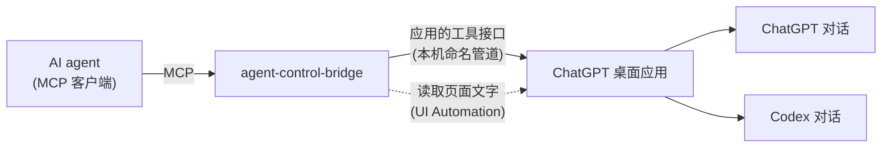

<div align="center">

# agent-control-bridge

**让 AI Agent 使用 ChatGPT 桌面应用里的 ChatGPT 与 Codex 对话**

列出 · 读取 · 新建 · 发送 · 几乎不打扰你

[](https://github.com/wynter-yaxley/agent-control-bridge/actions/workflows/ci.yml)
[](LICENSE)
[](https://nodejs.org/)
[](#准备)
[](https://modelcontextprotocol.io/)

简体中文 | [English](README_EN.md)

</div>

一个 MCP Server，让 AI agent 使用你电脑上 **ChatGPT 桌面应用** 里的 ChatGPT 对话和 Codex 对话：列出、读取、新建对话，发一条消息并拿回回复。

- **对话就在应用里**：消息由桌面应用自己执行，你在应用侧栏里能实时看到每一个对话和它的进度。
- **几乎不打扰你**：只有「新建 ChatGPT 对话」会把 ChatGPT 窗口短暂切到前台，发出消息后立即把前台还给你（读历史时如果应用没开，启动应用那一下也会，同样马上交还）；ACB 从不模拟键盘和鼠标。
- **一个工具只做一件事**：读取、新建、发送彼此独立，按需组合。
- **不会重复发送**：同一条消息超时后再调用，只会取回回复，不会再发一次。



## 工具一览

| 工具 | 作用 |
|---|---|
| `acb_codex_list` | 列出最近的 Codex 对话，可按文件夹筛选 |
| `acb_codex_read` | 读取 Codex 对话最近几轮的提问和回复 |
| `acb_codex_create` | 新建 Codex 对话（在某个项目里，或在新文件夹里），发出第一条消息 |
| `acb_codex_send` | 给 Codex 对话发消息，等它做完并返回回复 |
| `acb_gpt_list` | 列出最近的 ChatGPT 对话 |
| `acb_gpt_read` | 读取 ChatGPT 对话最近几轮的提问和回复 |
| `acb_gpt_history` | 从页面读取 ChatGPT 对话更早的轮次和完整回复正文，可以一直读到对话开头 |
| `acb_gpt_create` | 新建 ChatGPT 对话，发出第一条消息并返回回复 |
| `acb_gpt_send` | 给 ChatGPT 对话发消息并返回回复 |
| `acb_projects` | 列出应用里的项目 |
| `acb_open` | 在应用里打开某个对话，方便你旁观 |
| `acb_status` | 检查应用能否连通 |

## 哪些操作会打扰你

| 操作 | 抢占前台和键盘焦点 | 切换应用显示的页面 |
|---|---|---|
| 所有 Codex 工具；列出、读取对话；`acb_projects`、`acb_status` | 否 | 否 |
| `acb_gpt_send` | 否：消息在后台发出 | 是：发送前打开该对话，从页面读取回复正文 |
| `acb_gpt_read` 带 `page: true` | 否 | 是：打开该对话读取回复正文 |
| `acb_open` | 否 | 是 |
| `acb_gpt_history` | 通常否。只有应用没在运行时，ACB 会先启动它，应用窗口打开时会切到前台，ACB 随后把前台还给你。窗口被其他窗口完全挡住时，ACB 会把它临时提到最上层（不激活、不抢键盘焦点），读完放回原来的位置 | 是：打开该对话，并把页面上下滚动着读，读完滚回底部 |
| **`acb_gpt_create`** | **会，持续一两秒**：应用打开新聊天时会把 ChatGPT 窗口切到前台，ACB 发出消息后立即把前台还给你原来的窗口。ACB 不发送任何按键，但这一两秒内你按的键可能会落进 ChatGPT 的输入框 | 是 |

- 应用切换页面时偶尔也会把窗口切到前台。遇到这种情况，ACB 会立即把前台还给你原来的窗口；如果你已经切到了别的程序，ACB 不会去动它。
- 需要读取页面时，如果 ChatGPT 窗口是最小化的，ACB 会把它还原出来，但不激活它，你正在用的窗口仍保持在前台。

## 准备

- Windows 10 或 11
- [Node.js](https://nodejs.org/) 24.19 或更高，安装在 Windows 上
- ChatGPT 桌面应用（Microsoft Store 版，内含 Codex，2026 年 10 月及之后的版本），已登录
- 应用界面语言为**简体中文**：读取 ChatGPT 页面和新建 ChatGPT 对话依赖中文界面的控件名称
- 在应用里至少有过一个 Codex 对话和一个 ChatGPT 对话
- 一个支持 MCP 的客户端，例如 Claude Desktop、Claude Code、Hermes

## 安装

在 PowerShell 中：

```powershell
git clone https://github.com/wynter-yaxley/agent-control-bridge.git
cd agent-control-bridge
npm install
```

`npm install` 会顺带完成构建。

## 接入 MCP 客户端

在客户端的 MCP 配置里加入（路径换成你的实际路径）：

```json
{
  "mcpServers": {
    "acb": {
      "command": "C:\\Program Files\\nodejs\\node.exe",
      "args": ["D:\\agent-control-bridge\\dist\\mcp.js"]
    }
  }
}
```

Hermes 用户：

```powershell
hermes mcp add acb --command "C:\Program Files\nodejs\node.exe" --args "D:\agent-control-bridge\dist\mcp.js"
```

再把 [skills/agent-control-bridge](skills/agent-control-bridge/SKILL.md) 复制到 Hermes 的 skills 目录。这份 Skill 写明了每个工具的用法和注意事项；其他客户端也可以把它作为给 agent 的说明。

给 Codex 或 ChatGPT 发消息时，ACB 默认最多等 240 秒。请把客户端的工具超时设为 300 秒以上。

## 使用须知

**Codex 对话**

- 消息在应用里执行，使用的是应用里为该对话或项目设置的权限。Codex 需要你批准命令时，工具会返回 `NEEDS_USER`：请到应用里处理，之后用 `acb_codex_read` 查看结果。
- 应用把通过工具发来的消息显示为「转交」消息：发给已有对话的消息，显示为由这个对话自己转交；新建对话的第一条消息，显示为由「调用身份」对话转交（见下文）。
- 不指定项目时，新对话会建在 `文档\Codex\<日期>\<文件夹名>` 下。
- 已归档的对话，发消息时会自动取消归档。
- 耗时长的任务可以传 `wait: false` 立即返回，之后用 `acb_codex_read` 查看进度和结果。

**ChatGPT 对话**

- 你会在 ChatGPT 里看到普通的用户消息。
- 应用的对话记录里通常只保存回复的占位符，回复正文要从页面上读取。读取页面需要 ChatGPT 窗口**在屏幕上可见**：可以在别的窗口后面、可以被部分遮住，但不能被完全挡住（例如你正在全屏看视频），也不能在别的虚拟桌面上，因为这时应用不再更新页面。ACB 读页面前会先检查这一点。读不到时，发送仍然成功，结果里会标出 `replyOnPage` 和原因，之后用 `acb_gpt_read` 加 `page: true` 再读即可。
- 页面上看不到对话 ID，ACB 靠标题和提问确认页面就是要读的那一轮：页面上的最后几条提问必须和应用列出的各轮提问一致。如果应用列出的对话里有另一个 ChatGPT 对话和它同名，或者最近几轮的提问在循环重复（例如 Q、R、Q、R，这时停在旧状态的页面看起来也一样），就无法从页面读取（`WINDOW`）。前一种情况给其中一个改个名即可。
- **速度**：应用要在 ChatGPT 回复结束后最多一分钟才把这一轮记进对话记录。窗口可见时，`acb_gpt_send` 在页面上看到回复写完就返回（通常十几秒），这一轮的 `turnId` 暂时是 `null`；在应用记下它之前，同一个 ACB 进程里的 `acb_gpt_read` 会把它作为最新一轮返回。窗口看不到时，ACB 等应用记下这一轮，约一分钟。`acb_gpt_create` 总要等应用列出新对话，约一分钟。
- ChatGPT 窗口被完全挡住或最小化很久之后，应用会降低后台页面的活跃度，发送可能要等一分钟左右才真正发出。
- 新建 ChatGPT 对话时，如果新聊天页面的输入框里有你没发出的草稿，ACB 会拒绝，不会覆盖它。
- **读历史**：应用只返回最近 5 轮，而且回复多半只有占位符。`acb_gpt_history` 改为直接从页面读取：一段段往上滚动，按页面元素的 ID 把各段拼接起来，内容相同的轮次也不会混淆。页面滚到顶时会再加载更早的消息，ACB 会等它加载，直到对话开头。速度大约是 10 轮十几秒、50 轮半分钟到一分钟。返回的是页面上显示的文字：你手打的 Markdown 会是渲染后的样子，没有轮次 ID。如果你不在电脑前，应用没开时它会先启动应用；窗口被挡住时会临时把窗口提上来。屏幕需要保持解锁、显示器保持开启，因为锁屏或熄屏时应用不更新页面。

**通用**

- **不重复发送**：要发的内容如果和对话的最新一条消息完全相同（应用列出的、ChatGPT 页面上已经显示的，或者 ACB 刚发出、应用还没列出的那条），ACB 不会再发，而是返回那一轮的回复。如果一条消息发送结果未知（例如连接中途断开），而对话之后又被继续了超过应用能返回的轮数，ACB 就无法再确认它是否送达，这条提问不会再被自动发送（返回 `TIMEOUT`）。确实需要重复同样的内容时，请稍作改动。
- 单条消息最多 2 万字符：应用最多回读这么多，ACB 要完整回读才能确认回复属于哪条消息。发给 Codex 的消息里 `&`、`<`、`>` 会被转义，这类字符很多时上限会略低。更长的内容请写进文件，再在消息里引用。
- 对话正在回复时（包括 ChatGPT 页面上正在生成回复），新的消息会被拒绝（`BUSY`）。ChatGPT 页面已经显示这条提问、但 ACB 无法确认它与应用列出的消息的先后关系时，也会拒绝。页面只保留你正在看的位置附近的消息，所以你把 ChatGPT 页面往上翻到旧消息时，ACB 不从页面读取，改为等应用列出回复。
- 列表按应用侧栏的顺序排列：置顶的在前，其余默认按最近更新排序。应用只列出最近的 50 个对话（置顶的另算），更早的对话可以直接用 ID 读取。
- **调用身份**：应用要求每次调用都以一个 Codex 对话的名义进行。ACB 默认使用最近的 Codex 对话，也可以用 `--caller` 指定。这个对话里不会留下任何记录，只有新建 Codex 对话时，第一条消息会显示为由它转交。
- ACB 只和本机的桌面应用通信，自己不联网，不读取账号凭据。连接前会核对应用管道的服务端：必须是当前用户、当前 Windows 会话里、带 OpenAI 有效签名的 ChatGPT 应用。

## 出错时

先让 agent 调用 `acb_status`。错误结果里的 `error` 字段是下面的错误码之一：

| 错误码 | 意思 | 怎么办 |
|---|---|---|
| `UNAVAILABLE` | 应用没运行，或 ACB 不在 Windows 上运行 | 打开 ChatGPT 桌面应用 |
| `NOT_FOUND` | 对话不存在 | 检查 ID，或先列出对话 |
| `BUSY` | 对话正在回复 | 等它回复完，读取后再发 |
| `NEEDS_USER` | Codex 在等你批准或回答 | 到应用里处理 |
| `TIMEOUT` | 回复还没好 | 稍后读取对话；用同一条消息再调用也不会重发 |
| `FAILED` | 这一轮在应用里失败或被中断 | 看错误信息，必要时重新发送 |
| `WINDOW` | ChatGPT 窗口找不到、被完全挡住或无法操作 | 让窗口可见后重试 |
| `INPUT` | 参数不对 | 按提示修改参数 |
| `PROTOCOL` | 应用的回应不符合预期，通常是应用更新了 | 更新 ACB；问题仍在请提 Issue |

## 配置

不需要配置文件。需要时可以使用命令行参数或环境变量：

| 参数 | 环境变量 | 作用 | 默认 |
|---|---|---|---|
| `--caller <对话 ID>` | `ACB_CALLER` | 指定调用身份对话 | 最近的 Codex 对话 |
| `--timeout <秒>` | `ACB_TIMEOUT` | 发送后最多等待多久 | 240 |

## 开发

```powershell
npm ci
npm run lint; npm run typecheck; npm test   # 单元测试只用模拟数据
npm run smoke                               # 真机验收：会在应用里真实新建对话并发消息
```

| 文件 | 内容 |
|---|---|
| `src/mcp.ts` | 命令行入口 |
| `src/server.ts` | MCP 工具定义 |
| `src/pipe.ts` | 连接桌面应用的命名管道 |
| `src/desktop.ts` | 桌面应用工具接口的客户端 |
| `src/conversation.ts` | 发送、去重、等待回复 |
| `src/turns.ts` | 把应用的对话记录整理成提问和回复 |
| `src/codex.ts`、`src/chatgpt.ts` | 两类对话各自的操作 |
| `src/history.ts` | 从 ChatGPT 页面滚动读取历史轮次 |
| `src/helper.ts`、`src/helper.ps1` | Windows 辅助进程：核对管道服务端、读取和滚动 ChatGPT 页面、新建 ChatGPT 对话、启动应用、提升窗口 |

开发规则见 [AGENTS.md](AGENTS.md) 和 [CONTRIBUTING.md](CONTRIBUTING.md)，变更记录见 [CHANGELOG.md](CHANGELOG.md)。

## License

[MIT](LICENSE) · 依赖许可见 [THIRD_PARTY_NOTICES.md](THIRD_PARTY_NOTICES.md)
