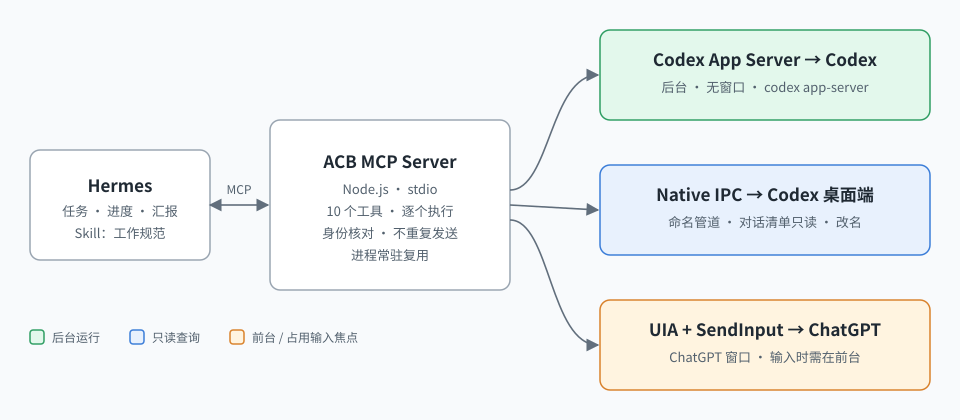
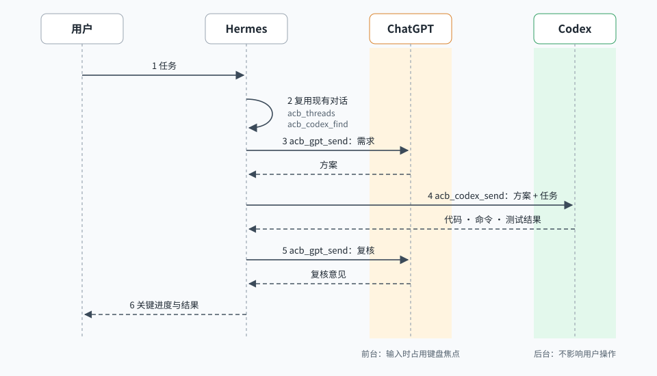

# Agent Control Bridge (ACB)

[](https://github.com/wynter-yaxley/agent-control-bridge/actions/workflows/ci.yml)
[](LICENSE)
[](https://nodejs.org/)
[](#requirements)
[](https://modelcontextprotocol.io/)
[](skills/agent-control-bridge/SKILL.md)

[中文](README.md)

ACB is an MCP server that lets Hermes (or any MCP client) drive the **ChatGPT desktop app** and the **Codex desktop app**: create workspaces and Codex projects, create or reuse conversations, send prompts and return the real replies, without the agent writing scripts.



## Requirements

Windows 10/11 (ChatGPT tools are Windows-only), Node.js 24.19+ on Windows, the Codex desktop app (signed in; its bundled `codex.exe` is found automatically), the ChatGPT desktop app (signed in) and Hermes on Windows or in WSL. The Codex tools only need `codex app-server` and may work on macOS/Linux, untested.

## Install and connect Hermes

```powershell
git clone https://github.com/wynter-yaxley/agent-control-bridge.git
cd agent-control-bridge
npm install        # installs and builds dist/
npm run check      # read-only self-check; prints the Hermes commands for this machine
```

Run the `hermes` commands printed by `npm run check` (one MCP registration and one skill copy, for Hermes on Windows or in WSL), for example:

```bash
hermes mcp add acb --command '/mnt/c/Program Files/nodejs/node.exe' --args 'D:\agent-control-bridge\dist\mcp.js' --allow-foreground-input
cp -r '/mnt/d/agent-control-bridge/skills/agent-control-bridge' ~/.hermes/skills/
```

Then start a new Hermes session (or `/reload-mcp`). Keep the server name `acb`. `--allow-foreground-input` authorizes restoring/activating the verified ChatGPT window and typing; without it ACB never activates or types and can only submit an identical draft while ChatGPT is already in front. A manual alternative is [config/hermes-mcp.example.yaml](config/hermes-mcp.example.yaml).

The skill [skills/agent-control-bridge/SKILL.md](skills/agent-control-bridge/SKILL.md) carries the working rules: Hermes coordinates, ChatGPT analyses and reviews, Codex builds and tests; reuse conversations; short reports; investigate only the direct cause of a failure; ask before non-core work. Hermes lists skills in every prompt and loads matching ones; check with `hermes skills list` or load it with `/agent-control-bridge`.

Configuration is optional: options, then `ACB_CODEX`, `ACB_CARRIER_THREAD`, `ACB_WORKSPACE_ROOT`, `ACB_ALLOW_FOREGROUND_INPUT=1`, `ACB_DEBUG=1`, `ACB_CONFIG`, then a JSON file ([config.example.json](config.example.json)), then discovery. Defaults: newest desktop `codex.exe`, the most recent Codex conversation as desktop context, `%USERPROFILE%\acb-workspaces`, a 240 s send timeout (below Hermes' 300 s tool timeout), no logs.

## Tools

| Tool | Arguments | Mode |
|---|---|---|
| `acb_status` | — | read-only self-check |
| `acb_threads`, `acb_projects` | — | read-only desktop inventory |
| `acb_workspace_create` | `name`, `path?` | background (directory + Codex project, idempotent) |
| `acb_codex_create` | `cwd`, `title`, `prompt?` | background |
| `acb_codex_find` | `searchTerm` | background, read-only |
| `acb_codex_send` | `threadId`, `prompt` | background |
| `acb_gpt_create` | `title`, `project?` (an existing ChatGPT project) | foreground typing |
| `acb_gpt_open` | `conversationId` | clicks in the ChatGPT window |
| `acb_gpt_send` | `conversationId`, `prompt` | foreground typing |

Errors are `{"ok":false,"code","message"}`. A repeated prompt is never resent: after `TIMEOUT`, call again with the same prompt to read the reply.

## Workflow



## Foreground and background

Codex and inventory tools run in the background. `--allow-foreground-input` explicitly authorizes ACB to restore a minimized, verified ChatGPT window and try to activate it once before GPT navigation/typing. It waits for restoration to complete, then requests focus once on that verified UIA window. It checks the actual Windows foreground handle and composer focus. If Windows refuses or the user changes windows/focus during input, ACB stops with `FOCUS_REQUIRED`, never repeatedly takes focus, and never submits the partial text. Without authorization it never activates or types; an identical draft can only be submitted while ChatGPT is already in front. No mouse, clipboard or focus-lock workaround is used. A Codex or unidentified window is refused. The user still approves Codex commands, creates ChatGPT projects, moves existing chats into projects and opens chats missing from the sidebar.

Single-line input uses SendInput. The editor collapses consecutive Shift+Enter breaks, so multiline input uses the verified composer's supported UIA ValuePattern in chunks, replacing only the exact prefix written by this operation and checking its text, foreground and focus after every write. Blank lines must read back exactly before submission.

Focus errors include `diagnostics.focusReason`: `activationDenied`, `foregroundChanged`, `composerFocusLost`, or `foregroundNotAuthorized`. They also include the actual `targetHandle`, `foregroundHandle`, and `typedLength` of the completed prefix in UTF-16 units, without prompt text. Foreground checks run immediately before writes, submission and failure cleanup; a focus loss leaves the draft untouched.

After an activation attempt, focus errors also include `diagnostics.activation`: `method`, restore-request acceptance (`restoreAccepted`), UIA request completion (`requestCompleted`), and an exception's `hresult`, as applicable. A completed request does not prove that the window became foreground.

## Limits

ChatGPT projects cannot be created and existing chats cannot be moved into one (the project list is invisible to UIA); a new chat can start in an existing project. ChatGPT exposes no conversation UUID in the window, so identity is "unique title + desktop inventory" (`uiIdentity: "titleOnly"`).

The native host returns at most 50 non-pinned chats plus pinned chats, uses sidebar sorting and has no pagination parameter. Missing inventory entries are never treated as proven identities. Creation uses only the left-sidebar New chat button, checks the blank page, sends one initialization marker, verifies its real ID and completion, then renames and checks native readback, the inventory entry for the same ID and the app page twice; a correct page UUID does not replace the inventory check. The sidebar can lag by about a minute; creation waits within its original timeout budget for agreement and writes no title once that budget is spent. Failure after submission returns `status: "partial"`, the known `conversationId` (null if unknown), actual `title`, `requestedTitle`, `identityVerified`, `stage` and relevant title verification results. Read that chat before further action; never create a replacement or resend the marker. `STATE` covers blank-page/composer verification; `PROVENANCE` covers conversation identity/persistence; `FOCUS_REQUIRED` covers activation/focus.

## Development

`npm ci`, `npm run typecheck`, `npm test` (mocks only), `npm run smoke -- --name ACB-smoke --path C:\temp\acb-smoke` (real Windows run, sends real messages). The PowerShell workers must stay UTF-8 with BOM; the build checks it. MIT licensed. Upgrading from 0.3: `--carrier-thread` and `--codex` are optional, the default timeout is 240 s, `acb_status` is new, `scripts/acceptance.mjs` is now `npm run smoke`; existing tool names and arguments are unchanged.

After a smoke failure, `--gpt-conversation <known ID> --codex-thread <known ID>` resumes those isolated chats without recreating them or resending initialization markers. The optional project test is skipped without `--gpt-project`.
