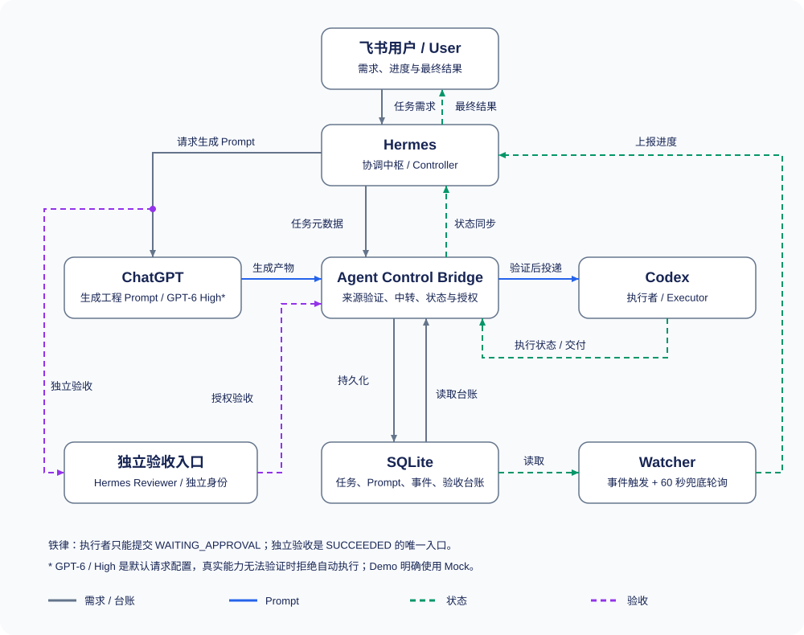

# Agent Control Bridge

[简体中文](README.md)

Agent Control Bridge is a local task-control and state-management bridge connecting Hermes, ChatGPT and Codex. It provides a task ledger, progress observation and independent review interfaces for Hermes on Feishu: ChatGPT generates engineering prompts, the bridge verifies and relays them, and Codex performs development.

Each Agent retains its role: Hermes coordinates and reports to users; ChatGPT communicates and generates prompts; Codex develops; Bridge controls provenance, permissions and state; SQLite preserves traceable records. The project serves collaboration among existing desktop Agents and does not provide model inference.

## Core capabilities

- **Task lifecycle**: atomic claims, version conflicts, leases, progress, delivery, cancellation and explicit recovery.
- **Independent review**: executors submit work pending review; an authorized independent reviewer is the only entry to `SUCCEEDED`.
- **Prompt relay interfaces**: verify trusted provenance, conversations, model capabilities and content hashes; record delivery and retain uncertain outcomes for investigation.
- **SQLite ledger**: tasks, events, approvals, provenance, reviews and durable notifications; controlled Schema upgrades.
- **Watcher**: event-triggered checks with periodic fallback, notification deduplication, restart recovery and overdue-blocking records.
- **Desktop tools**: restricted CDP reads and authorized sending interfaces, writes disabled by default; no physical mouse or keyboard takeover.
- **Credential-free Demo**: isolated Mocks demonstrate ChatGPT → Bridge → Codex → Watcher → independent review.

**Current limits**: the desktop generation adapter cannot yet independently prove GPT-6/High, so production automatic prompt delivery is refused by default. Feishu sending needs a Hermes message adapter. Codex history is a snapshot and does not fully reveal background execution; ledger cancellation does not prove the actual Agent stopped. See [deployment](docs/DEPLOYMENT.md).

## Architecture



```text
User requirement → Hermes → ChatGPT prompt → Bridge verification/relay → Codex execution
                                 Bridge ← state and delivery ← Codex
                                    ↕ SQLite              ↓ Watcher
User ← Hermes report ← independent review entry → Bridge final state
```

Each project registers **one Codex workspace + N Codex conversations in that workspace + one GPT conversation**. The GPT conversation name must match the workspace project name; development, tests and delivery occur in registered Codex conversations. New projects use isolated sets, and production adapters must independently check actual conversations.

## Quickstart

### Requirements

The core CLI requires **Node.js >=24.19.0, npm and Git**. It uses Node's built-in SQLite, without third-party runtime dependencies or native SQLite extensions. Core targets Windows/Linux. Desktop integration targets Windows and needs Python >=3.10, optional `websocket-client`, installed and signed-in Agent applications, and controlled CDP. Demo needs none of these desktop prerequisites.

```sh
git clone https://github.com/wynter-yaxley/agent-control-bridge.git
cd agent-control-bridge
npm install
npm run build
npm test
node dist/cli.js help
node dist/cli.js demo
```

`demo` creates and removes a unique temporary database. It demonstrates test prompt generation, relay, Codex claim, progress, Watcher, delivery, executor self-review denial, independent Mock review and final query. `mock-chatgpt` provenance and `mock:gpt-6` model names explicitly identify test data. It invokes no paid model and reads no business database. Ordinary configuration or environment variables cannot enable production Mock authority.

### Initialize a local ledger

PowerShell:

```powershell
Copy-Item config.example.json .bridge.config.json
node dist/cli.js init --config .bridge.config.json
node dist/cli.js config-show --config .bridge.config.json
node dist/cli.js schema-version
```

Other shells can use `cp config.example.json .bridge.config.json`. External Agents and desktop operations are disabled by default; use a dedicated restricted data directory. See [deployment](docs/DEPLOYMENT.md) for a real environment.

## Configuration

Priority: **explicit CLI options > matching environment variables > local configuration > built-in defaults**. `--config` or `ACB_CONFIG` selects the file; `--db` overrides the database path. Relative data paths in a configuration file resolve from its directory. Environment and CLI database paths resolve from the working directory. Unknown fields, invalid types and unsafe endpoints are rejected.

| Setting | Default and purpose | Environment override |
|---|---|---|
| `database.path` | `./data/bridge.db`, dedicated ledger directory | `ACB_DB_PATH` |
| `database.busyTimeoutMs` | `5000`, bounded SQLite lock wait | — |
| `watcher.intervalMs` | `60000`, cross-process polling fallback | `ACB_WATCH_INTERVAL_MS` |
| `watcher.timeoutMs` | `10000`, cooperative inspection budget | — |
| `failureReporting.blockedAfterMs` | `600000`, persistent-blocking reporting threshold | `ACB_BLOCKED_REPORT_MS` |
| `agents.chatgpt.model` | `gpt-6`, requested model, not verified actual execution | `ACB_CHATGPT_MODEL` |
| `agents.chatgpt.reasoningEffort` | `high`, requested reasoning effort | `ACB_CHATGPT_REASONING` |
| `desktop.cdpUrl` | Local loopback endpoint; concrete example in configuration | `ACB_CDP_URL` |
| `desktop.enabled` / `allowForegroundAutomation` | `false`; configuration still grants no one-time approval | — |
| `desktop.allowPhysicalInput` | `false`; physical input is unsupported | — |

Local events can trigger immediate Watcher checks; cross-process changes rely on periodic fallback. With timely inspections and a responsive event loop, the target is one period plus inspection and scheduling delays, **not an unconditional worst-case 60-second SLA**. Blocking notifications are local ledger events; Hermes must consume them and actually report to the user. See [config.example.json](config.example.json) for all fields.

## Usage

### Manual ledger walkthrough

These operations record state and do not automatically execute code. The default CLI caller is `pi` without reviewer rights, so this walkthrough uses `pi`. A production Codex claim additionally requires a verified and delivered ChatGPT prompt.

```sh
node dist/cli.js task-create -t "Local ledger walkthrough" -k demo -e pi
node dist/cli.js task-list --status QUEUED
node dist/cli.js task-claim TASK_ID --version 0 -e pi
node dist/cli.js task-progress TASK_ID --version 1 --note "Manually simulated development"
node dist/cli.js task-renew TASK_ID --version 2 --lease 600
node dist/cli.js task-finish TASK_ID --version 3 --note "Delivery pending independent review"
node dist/cli.js task-show TASK_ID
node dist/cli.js watch
```

Replace `TASK_ID` with the returned UUID and use the latest queried version for each operation. `watch` is a separate observation process; stopping its terminal does not stop an external Agent. Only a deployed independent reviewer OS identity may run:

```sh
node dist/cli.js task-verify TASK_ID --version 4 --pass --reason "Independently checked delivery"
node dist/cli.js task-show TASK_ID
node dist/cli.js status
```

SQLite stores review results and final state is queryable; a Hermes message adapter sends actual user notifications. Use `demo` for the full walkthrough without identity deployment.

### State machine and permissions

```text
QUEUED → RUNNING → WAITING_APPROVAL → independent verify(pass) → SUCCEEDED
                  WAITING_APPROVAL → independent verify(fail) → FAILED
RUNNING ⇄ BLOCKED
expired RUNNING/BLOCKED → independent recover → FAILED → reviewer requeue → QUEUED
UNKNOWN → reviewer requeue → QUEUED
eligible active state → owner cancel → CANCELLED
```

`--by`, executor names, role strings and environment variables grant no authority. Caller identity comes from the OS principal and protected policy; updates check version, holder, instance and attempt. Executors cannot review themselves, and ordinary SQL final-success writes also have a review gate. Owners who can edit host code, policy or data belong to the trusted boundary; this ledger cannot isolate arbitrary malicious code sharing the same OS account. Linux currently supports the single-user core CLI and Demo; shared writable review across UIDs is not provided. See [identity and security](docs/DEPLOYMENT.md).

The project does not obtain, copy, display, persist or modify credentials, Cookies or session Tokens. Business databases, personal configuration, logs, Profiles and caches are ignored. Keep private business content out of messages and logs as well.

### Real desktop mode and extension

Install and sign into external applications, configure local CDP, then have a trusted host install generation/transport adapters and register workspace/GPT/Codex conversations. If ChatGPT's actual model, effort or provenance cannot be verified, the artifact remains `REVIEW_REQUIRED`; reliable proof is required for automatic Codex execution. Manual file imports never authorize execution.

Desktop sending may change editing focus and requires one-time trusted host approval; CLI options cannot authorize it. Defaults expose restricted reading and diagnostics only, and never restart an application in use. See [desktop tools](tools/desktop/README.md) for parameters, compatibility entries and failures, and [deployment](docs/DEPLOYMENT.md) for recovery.

Additional Agents can implement narrow capability interfaces and register trusted adapters; new executor kinds also need compatible type and Schema extensions. See [development](docs/DEVELOPMENT.md).

### Troubleshooting

Successful JSON uses stdout; error JSON uses stderr. Exit codes: `1` file/I/O; `2` input/configuration; `3` authority/provenance; `4` state/version/lease/review; `5` database/Schema; `6` Agent/capability/dependency; `7` timeout; `8` execution failure.

Run `init` for an absent database and re-query versions after conflicts. Back up legacy databases and test `migrate --db COPY.sqlite` on a copy; ordinary writes reject implicit upgrades. For AUTH/PROVENANCE errors check protected identity or adapters rather than bypassing with labels. Unreachable CDP alone does not prove a crash and cannot authorize an automatic restart.

## License and documentation

[MIT License](LICENSE); see [third-party notices](THIRD_PARTY_NOTICES.md) for dependencies.

- [Deployment and recovery](docs/DEPLOYMENT.md)
- [Project collaboration rules](docs/PROJECT_RULES.md)
- [Contributing](CONTRIBUTING.md) and [development](docs/DEVELOPMENT.md)
- [Historical audit](docs/audit/CODE_AUDIT_REPORT.md), [remediation](docs/audit/REMEDIATION.md) and [delivery record](docs/audit/DELIVERY.md)
