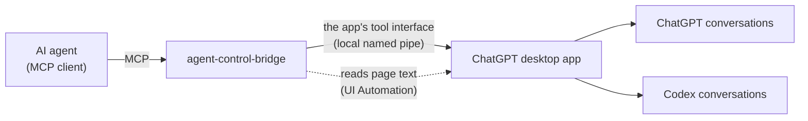

# agent-control-bridge

[](https://github.com/wynter-yaxley/agent-control-bridge/actions/workflows/ci.yml)
[](LICENSE)
[](https://nodejs.org/)
[](#requirements)
[](https://modelcontextprotocol.io/)

[中文](README.md)

An MCP server that lets AI agents use the ChatGPT and Codex conversations of the **ChatGPT desktop app** on your computer: list, read and start conversations, send a message and get the reply.

- **Conversations stay in the app**: the desktop app runs every message itself, so you see each conversation and its progress live in the sidebar.
- **Hardly in your way**: only "start a ChatGPT conversation" brings the ChatGPT window to the front, briefly, and ACB hands the foreground back as soon as the message is sent; ACB never simulates keyboard or mouse input.
- **One tool, one job**: reading, starting and sending are independent and combine as needed.
- **No duplicate messages**: calling again with the same message after a timeout returns the reply instead of sending it twice.



## Tools

| Tool | What it does |
|---|---|
| `acb_codex_list` | List recent Codex conversations, optionally of one folder |
| `acb_codex_read` | Read the prompts and replies of a Codex conversation's newest turns |
| `acb_codex_create` | Start a Codex conversation (in a project or a new folder) with a first message |
| `acb_codex_send` | Message a Codex conversation, wait until it is done and return the reply |
| `acb_gpt_list` | List recent ChatGPT conversations |
| `acb_gpt_read` | Read the prompts and replies of a ChatGPT conversation's newest turns |
| `acb_gpt_create` | Start a ChatGPT conversation with a first message and return the reply |
| `acb_gpt_send` | Message a ChatGPT conversation and return the reply |
| `acb_projects` | List the app's projects |
| `acb_open` | Show a conversation in the app so you can watch it |
| `acb_status` | Check that the app can be reached |

## What affects you

| Operation | Takes the foreground and keyboard focus | Switches the page the app shows |
|---|---|---|
| All Codex tools; listing and reading; `acb_projects`, `acb_status` | No | No |
| `acb_gpt_send` | No: the message is sent in the background | Yes: before sending, the conversation is shown to read the reply text |
| `acb_gpt_read` with `page: true` | No | Yes: the conversation is shown to read the reply text |
| `acb_open` | No | Yes |
| **`acb_gpt_create`** | **Yes, for a second or two**: the app activates the ChatGPT window when it opens a new chat; ACB gives the foreground back to your window as soon as the message is sent. ACB sends no keystrokes, but keys you press during those seconds can land in ChatGPT's composer | Yes |

- The app occasionally brings its window to the front when it switches pages. ACB then gives the foreground back to your window at once; if you have switched to another program yourself, ACB leaves it alone.
- When the page must be read and the ChatGPT window is minimized, ACB restores it without activating it; the window you are using stays in front.

## Requirements

- Windows 10 or 11
- [Node.js](https://nodejs.org/) 24.19 or later, installed on Windows
- The ChatGPT desktop app (Microsoft Store, includes Codex, October 2026 or later), signed in
- The app's language set to **Simplified Chinese**: reading the ChatGPT page and starting ChatGPT conversations rely on its control names
- At least one Codex and one ChatGPT conversation in the app
- An MCP client such as Claude Desktop, Claude Code or Hermes

## Install

In PowerShell:

```powershell
git clone https://github.com/wynter-yaxley/agent-control-bridge.git
cd agent-control-bridge
npm install
```

`npm install` also builds the server.

## Connect an MCP client

Add to the client's MCP configuration (use your actual paths):

```json
{
  "mcpServers": {
    "acb": {
      "command": "C:\\Program Files\\nodejs\\node.exe",
      "args": ["D:\\agent-control-bridge\\dist\\mcp.js"]
    }
  }
}
```

Hermes:

```powershell
hermes mcp add acb --command "C:\Program Files\nodejs\node.exe" --args "D:\agent-control-bridge\dist\mcp.js"
```

Then copy [skills/agent-control-bridge](skills/agent-control-bridge/SKILL.md) into Hermes' skills folder. The skill explains every tool and its caveats; other clients can use it as instructions for the agent.

A send waits up to 240 seconds by default. Set the client's tool timeout to 300 seconds or more.

## Good to know

**Codex conversations**

- Messages run in the app with the permissions the app has for that conversation or project. When Codex needs your approval, the tool returns `NEEDS_USER`: handle it in the app, then check the result with `acb_codex_read`.
- The app shows messages sent through its tools as delegated messages: a message to an existing conversation as delegated by that conversation itself; the first message of a new conversation as delegated by the caller conversation (see below).
- Without a project, a new conversation is created under `Documents\Codex\<date>\<folder>`.
- Archived conversations are restored when you message them.
- For long tasks, pass `wait: false` to return at once, then follow progress and the result with `acb_codex_read`.

**ChatGPT conversations**

- ChatGPT shows your messages as ordinary user messages.
- The app's record of a conversation usually keeps only a placeholder for each reply; the text is read from the page. Reading the page needs the ChatGPT window **visible on screen**: behind other windows or partly covered is fine, fully covered (say, by a full-screen video) is not. If the page cannot be read, the send still succeeds; the result marks `replyOnPage` with the reason, and `acb_gpt_read` with `page: true` reads it later.
- The page shows no conversation ID, so ACB confirms it shows the turn to read by the conversation's title and its last two prompts. If another ChatGPT conversation the app lists has the same title, the reply cannot be read from the page (`WINDOW`); rename one of them.
- **Speed**: the app records a ChatGPT turn up to a minute after the reply ends. With the window visible, `acb_gpt_send` returns as soon as the page shows the finished reply (usually within 10-20 seconds), with `turnId: null` for now; until the app records the turn, `acb_gpt_read` in the same ACB process returns it as the newest turn. Without a visible window, ACB waits for the app to record it, about a minute. `acb_gpt_create` always waits for the app to list the new conversation, about a minute.
- After the ChatGPT window has been fully covered or minimized for a long time, the app slows down its background page, and a message can take about a minute to go out.
- If the new-chat page holds a draft you have not sent, starting a ChatGPT conversation is refused rather than overwriting it.

**In general**

- **No duplicates**: if the message to send is exactly the conversation's newest message, or the one ACB just sent and the app does not show yet, ACB does not send it again and returns that turn's reply. To repeat the same text on purpose, change it slightly.
- A message can have up to 20,000 characters: the app reads back no more, and ACB must read a message back whole to know which reply belongs to it. Messages to Codex have `&`, `<` and `>` escaped, so many of those lower the limit a little. Put longer material in a file and refer to it.
- A conversation that is still answering refuses new messages (`BUSY`).
- Lists follow the app's sidebar: pinned first, then most recently updated by default. The app lists the 50 most recent conversations (plus pinned ones); older ones can still be read by ID.
- **Caller**: the app requires every call to be made on behalf of a Codex conversation. ACB uses the most recent one, or the one given with `--caller`. Nothing is recorded in that conversation; only the first message of a new Codex conversation is shown as delegated by it.
- ACB talks only to the desktop app on this computer. It does not go online by itself and does not read account credentials. Before connecting, it checks the server of the app's pipe: the ChatGPT app with a valid OpenAI signature, run by the current user in the current Windows session.

## Errors

Ask the agent to call `acb_status` first. The `error` field of a failed result is one of:

| Code | Meaning | What to do |
|---|---|---|
| `UNAVAILABLE` | The app is not running, or ACB does not run on Windows | Start the ChatGPT desktop app |
| `NOT_FOUND` | The conversation does not exist | Check the ID, or list conversations first |
| `BUSY` | The conversation is still answering | Wait, read it, then send |
| `NEEDS_USER` | Codex waits for your approval or answer | Handle it in the app |
| `TIMEOUT` | The reply is not ready yet | Read the conversation later; calling again with the same message does not resend it |
| `FAILED` | The turn failed or was interrupted in the app | Read the message; send again if needed |
| `WINDOW` | The ChatGPT window is missing, fully covered or cannot be used | Make the window visible and retry |
| `INPUT` | An argument is invalid | Fix the argument as described |
| `PROTOCOL` | The app answered unexpectedly, usually after an app update | Update ACB; open an issue if it persists |

## Configuration

No configuration file. Optional command-line options and environment variables:

| Option | Environment variable | Purpose | Default |
|---|---|---|---|
| `--caller <conversation ID>` | `ACB_CALLER` | The caller conversation | The most recent Codex conversation |
| `--timeout <seconds>` | `ACB_TIMEOUT` | How long a send waits for the reply | 240 |

## Development

```powershell
npm ci
npm run lint; npm run typecheck; npm test   # unit tests use simulated data only
npm run smoke                               # acceptance run: really starts conversations and sends messages
```

| File | Contents |
|---|---|
| `src/mcp.ts` | Command-line entry point |
| `src/server.ts` | MCP tool definitions |
| `src/pipe.ts` | Connection to the desktop app's named pipe |
| `src/desktop.ts` | Client of the desktop app's tool interface |
| `src/conversation.ts` | Sending, duplicate check, waiting for the reply |
| `src/turns.ts` | Turns the app's records into prompts and replies |
| `src/codex.ts`, `src/chatgpt.ts` | Operations of each kind of conversation |
| `src/helper.ts`, `src/helper.ps1` | Windows helper: checking the pipe's server, reading the ChatGPT page, starting ChatGPT conversations |

See [AGENTS.md](AGENTS.md) and [CONTRIBUTING.md](CONTRIBUTING.md) for development rules and [CHANGELOG.md](CHANGELOG.md) for changes.

## License

[MIT](LICENSE) · Dependency licenses: [THIRD_PARTY_NOTICES.md](THIRD_PARTY_NOTICES.md)
